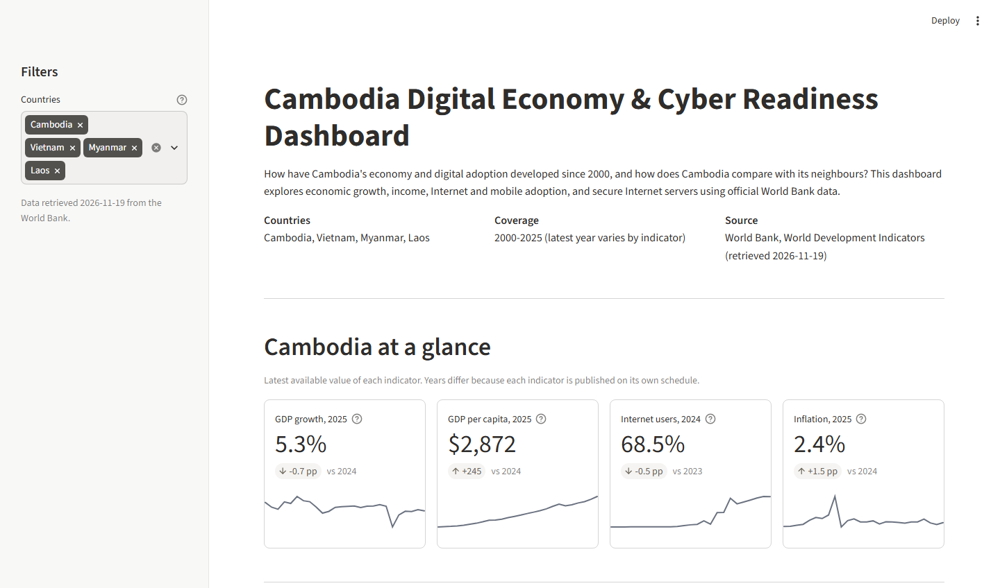
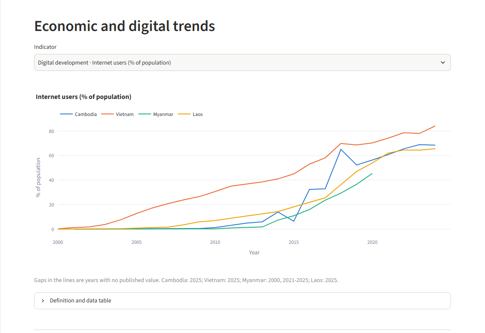
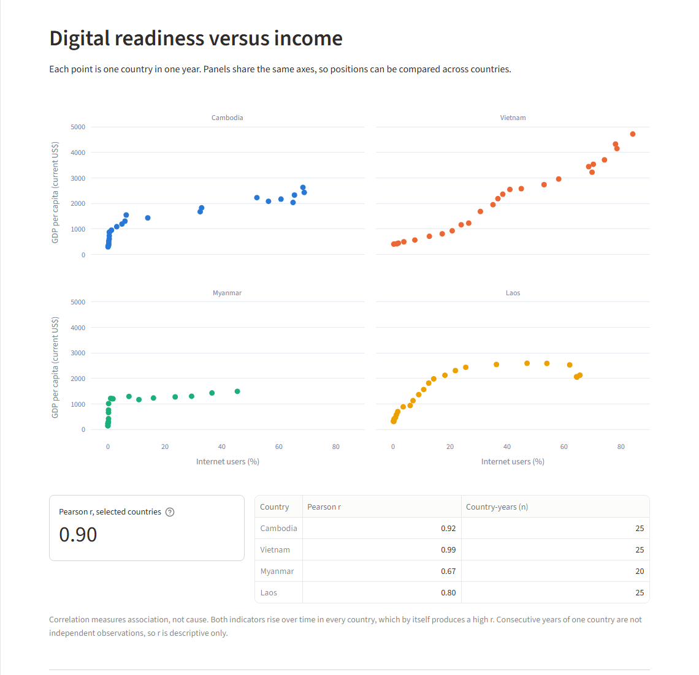

# Cambodia Digital Economy & Cyber Readiness Dashboard

An interactive data analytics project that tracks Cambodia's economic growth and
digital development from 2000 to the latest available year, compared with
Vietnam, Myanmar and Laos, using official World Bank data.

**Live dashboard:** *link added after deployment*
**Analysis notebook:** [`notebooks/analysis.ipynb`](notebooks/analysis.ipynb)
(GitHub's preview shows the tables and findings; open it in Jupyter or VS Code to
see the interactive charts)



## Why I built this

I'm a final-year Cybersecurity student in Phnom Penh who also studies Economics.
I wanted one project that joins both sides: how Cambodia's economy has grown, how
quickly the country has gone online, and what public data can (and cannot) say
about its digital infrastructure. I also wanted to practise the full analyst
workflow end to end: collecting data from an API, validating it, analysing it,
and presenting it in a dashboard someone else can use.

## Research questions

1. How has Cambodia's GDP growth changed since 2000?
2. How does Cambodia's GDP per capita compare with its neighbours?
3. How has Internet adoption developed across the four countries?
4. How has mobile connectivity changed over time?
5. Is higher Internet adoption associated with higher GDP per capita?
6. How has the number of secure Internet servers changed in each country?
7. What differences exist between Cambodia and its neighbouring economies?

## Key findings

From World Bank data retrieved on 2026-11-19. Full analysis in the notebook.

1. **Growth:** Cambodia's real GDP growth averaged **7.17% a year (2000-2025)**, the
   highest of the four. Its average fell from 8.96% (2000-2009) to 7.58% (2010-2019)
   and 3.51% (2020-2025); its only contraction was 2020 (-3.56%).
2. **Income:** GDP per capita rose from **$296 (2000) to $2,872 (2025)** in current
   US$ (not inflation-adjusted). Cambodia has been above Laos every year since 2022;
   Vietnam's level is 1.76 times Cambodia's.
3. **Internet:** Internet users went from **0.05% (2000) to 68.48% (2024)** of the
   population. Cambodia passed 50% in 2018, two years after Vietnam and two before Laos.
4. **Secure servers:** Cambodia rose from 0.69 to **817.3 per million people
   (2010-2024)**; Vietnam's 2024 value is 7.0 times higher.
5. **Internet vs income:** Pearson **r = 0.90** across 95 country-years. Both indicators
   rise over time, so this is an association, not evidence that one causes the other.

## Dashboard

| Trends by indicator and country | Internet use vs GDP per capita |
|---|---|
|  |  |

The dashboard has six sections: introduction, Cambodia KPI cards (each showing its
own observation year), an indicator/country trend explorer, the Internet vs income
scatter with correlation, key insights, and data methodology. The key insights are
**calculated from the dataset when the page loads**, not typed in, so they stay correct
if the data is refreshed. It supports light and dark mode and works on phones.

## Data

Source: **World Bank, World Development Indicators** (licence: CC BY 4.0), accessed
through the [World Bank Indicators API](https://datahelpdesk.worldbank.org/knowledgebase/articles/889392).

| Indicator | Code | Unit | Real values (of 104) | Latest year |
|---|---|---|---|---|
| GDP growth | `NY.GDP.MKTP.KD.ZG` | annual % | 104 | 2025 |
| GDP per capita | `NY.GDP.PCAP.CD` | current US$ | 104 | 2025 |
| Inflation, consumer prices | `FP.CPI.TOTL.ZG` | annual % | 98 | 2025 (Myanmar 2019) |
| FDI net inflows | `BX.KLT.DINV.WD.GD.ZS` | % of GDP | 104 | 2025 |
| Personal remittances received | `BX.TRF.PWKR.DT.GD.ZS` | % of GDP | 77 | 2025 (Vietnam 2004, Myanmar 2019) |
| Individuals using the Internet | `IT.NET.USER.ZS` | % of population | 95 | 2024 (Myanmar 2020) |
| Mobile cellular subscriptions | `IT.CEL.SETS.P2` | per 100 people | 99 | 2024 (Laos 2023) |
| Secure Internet servers | `IT.NET.SECR.P6` | per 1 million people | 60 | 2024 (data start 2010) |

104 = 4 countries x 26 years (2000-2025). **Missing values are kept as missing**:
never estimated, never replaced with zero. The dataset has 832 rows, 91 of them
without a published value.

> **About "Secure Internet servers":** this counts publicly-trusted TLS/SSL
> certificates found by Netcraft's Secure Server Survey, by hosting country, per
> million people. It is a **digital infrastructure** indicator. It is **not** a
> measure of cybersecurity readiness or national cyber resilience.

## How it works

```
World Bank API ──► fetch_data.py ──► data/cambodia_econ.csv ──► notebooks/analysis.ipynb
  (REST, JSON)     download,          data/metadata.json    └──► app.py (Streamlit dashboard)
                   validate, clean    (retrieval time, sources,
                                       latest year per series)
```

- **`fetch_data.py`** calls the API once per indicator with a timeout and retries,
  converts the JSON into a tidy long-format table (`country, country_code, year,
  indicator, indicator_code, value`), validates it (codes, years, duplicates, data
  types, plausible ranges), and saves it only if everything passes. If an indicator
  fails, it reports the failure and saves nothing.
- **`notebooks/analysis.ipynb`** covers data inspection, descriptive statistics,
  growth, digital development and correlation analysis, then written findings.
- **`app.py`** reads the saved CSV (never the live API), so it loads quickly and
  shows exactly the data that was validated.

## Project structure

```
cambodia-digital-economy/
├── data/
│   ├── cambodia_econ.csv     # tidy dataset (832 rows)
│   └── metadata.json         # retrieval time, source, definitions, latest years
├── notebooks/
│   └── analysis.ipynb        # exploratory data analysis
├── screenshots/              # dashboard images used in this README
├── .streamlit/
│   └── config.toml           # neutral widget colour, no usage statistics
├── fetch_data.py             # data collection and validation
├── app.py                    # Streamlit dashboard
├── requirements.txt          # pinned runtime dependencies
└── .gitignore
```

## Run it yourself

Requires Python 3.11 or newer (pandas 3 and Streamlit need it; built with Python 3.14).

```bash
git clone https://github.com/Reach488/cambodia-digital-economy.git
cd cambodia-digital-economy

python -m venv .venv
.venv\Scripts\Activate.ps1        # Windows PowerShell
# source .venv/bin/activate       # macOS / Linux

python -m pip install -r requirements.txt
```

**Run the dashboard** (the dataset is included, so this works straight away):

```bash
streamlit run app.py
```

**Refresh the data from the World Bank** (optional, takes about 1-5 minutes;
the API is sometimes slow):

```bash
python fetch_data.py
```

**Open the notebook** (Jupyter is a development tool, so it is not in
`requirements.txt`):

```bash
python -m pip install notebook
python -m jupyter notebook notebooks/analysis.ipynb
```

## Tech stack

| Tool | Used for |
|---|---|
| Python 3.14 | Everything |
| requests | Calling the World Bank REST API (timeouts, retries) |
| pandas 3 | Cleaning, validation, reshaping, statistics |
| Plotly Express | Interactive charts |
| Jupyter | Exploratory analysis |
| Streamlit | Dashboard and deployment |

## What I learned

- **APIs can fail quietly.** The World Bank API returns HTTP 200 *with an error
  message in the body* for an invalid indicator code, so the script checks the
  response content, not just the status code. Response times varied from 1 to 54
  seconds, which is why the script uses timeouts and retries.
- **Missing is not zero.** Filling gaps with 0 would claim "0% of people used the
  Internet". Keeping NaN, reporting the latest year per series, and showing gaps in
  charts is more honest.
- **Long (tidy) data makes everything simpler:** one structure for every indicator,
  and pivoting to wide only when needed (e.g. for correlation).
- **Correlation needs context.** r = 0.90 looks impressive, but two series that both
  rise over time will correlate. Sample size, per-country results and shared trends
  matter more than the headline number.
- **Chart colours can be tested.** A colour-blindness check showed four colours in one
  scatter plot were too similar, so the scatter uses one panel per country instead.
- **Reproducibility details:** a hand-written `requirements.txt` instead of
  `pip freeze` (which listed 110 packages, including the Windows-only `pywinpty`
  that would break a Linux deployment), and a `metadata.json` that records when
  the data was retrieved.

## Limitations and possible improvements

- Four countries over about 25 years is a small sample, and consecutive years of one
  country are not independent, so the correlations are descriptive only.
- GDP per capita in current US$ is affected by inflation and exchange rates; a
  constant-price or PPP measure would compare real living standards better.
- Recent values (2024-2025) may be revised in later World Bank releases.
- Secure Internet servers is a narrow infrastructure measure. A fuller picture of cyber
  readiness could add sources such as the ITU Global Cybersecurity Index.
- Possible next steps: add more ASEAN countries, compare year-to-year *changes* rather
  than levels in the correlation analysis, and refresh the data automatically on a
  schedule.

## Data licence and attribution

Data: The World Bank, World Development Indicators, licensed under
[CC BY 4.0](https://creativecommons.org/licenses/by/4.0/). This project is not
affiliated with or endorsed by the World Bank.

---

Built by [Reach488](https://github.com/Reach488).
